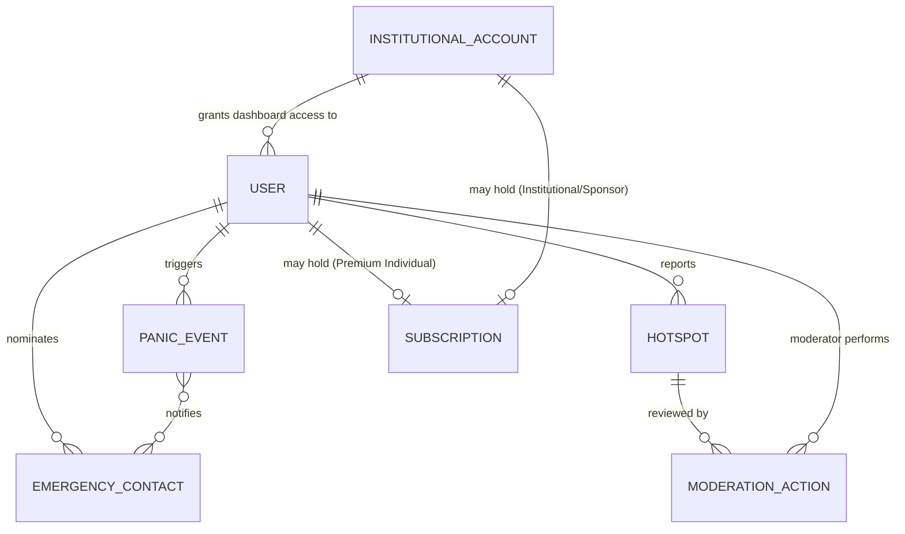
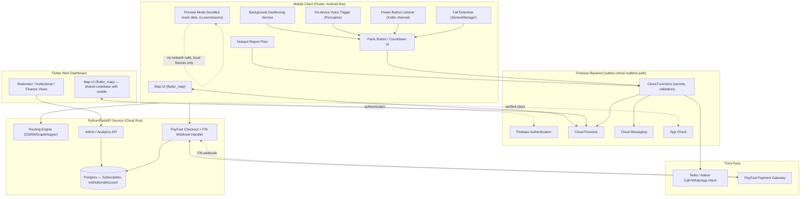

# Software Requirements Specification (SRS)

## SafeHer — Crowd-Sourced Safety Map & Hands-Free Panic Response

**Version:** 1.2
**Date:** 2026-09-25
**Source document:** `SafeHer_SDLC.docx` (Bloom Innovators — BizTech Nexus Innovation Hackathon 2026)
**Prepared as:** Full-stack engineering translation of the SDLC into an implementation-ready SRS (IEEE 830 structure)

**v1.1 changelog:** replaced Leaflet.js with a unified `flutter_map` stack (mobile + Flutter Web); added a Python/FastAPI backend alongside Firebase for payments, routing, and admin/analytics; added PayFast as the subscription/payment processor; added a cross-role Preview Mode backed by seeded mock data; added a detailed Flutter/backend technology inventory (§11) and a Lean Canvas–to-engineering mapping (§12).

**v1.2 changelog — moderator-driven scope correction:** external review judged the project "emotionally compelling, technically and operationally under-developed, and potentially harmful if shipped carelessly." Three directives followed, all now binding on this SRS: (1) scope down hard for the MVP — see the new §2.8 tiering; (2) treat the panic pipeline and all personal/location data as safety-critical systems, not features, with correctness and honest failure-reporting prioritised over feature breadth; (3) **drop every claim of automatic police/emergency-services response** until an actual dispatch channel (an MOU, an API, a monitored line) exists — `FR-PANIC-1` and the panic pipeline design have been rewritten accordingly, and the equivalent "escalate to police" step already present in `SafeHer_Algorithm_Test_Plan.md` §2 has been removed. No shipped or demoed build may imply police involvement it cannot actually deliver.

---

## 1. Introduction

### 1.1 Purpose

This document specifies the functional and non-functional requirements for **SafeHer**, a mobile safety application that lets women crowd-source crime hotspots onto a shared live map and provides multiple hands-free ways to trigger an emergency panic response. It translates the narrative SDLC document into requirements a development team can build, test, and trace directly to code (Firestore rules, Flutter widgets, Cloud Functions, native Android services).

### 1.2 Scope

SafeHer consists of:

- An **Android-first Flutter mobile app** (client) for end users — map view, hotspot reporting, panic triggers, next-of-kin management.
- A **hybrid backend**: Firebase (Firestore realtime data + Authentication + Cloud Messaging + App Check) for the safety-critical realtime paths, plus a **Python/FastAPI** service for payment processing, routing computation, and admin/analytics workloads that don't fit the Cloud Functions model well.
- A **Flutter Web admin/public dashboard** — the same `flutter_map` widget and much of the same widget/business-logic code as the mobile app, compiled for web, for NGOs, community/municipal partners, and moderators. Leaflet.js is not used; the map layer is unified on `flutter_map` across mobile and web so there is one map codebase, not two.
- **Subscription & payments** via **PayFast** — South Africa's dominant local gateway (card, EFT, Instant EFT, ZAR-native, no cross-border card processing needed) — for the Premium Individual and Institutional Licence tiers.
- A **Preview Mode**, available to every user role without an account or any sensitive permission grant, populated with seeded mock data — for onboarding, Play Store sensitive-permission review, and institutional sales demos.
- **Native platform integrations**: background power-button interception, on-device voice keyword spotting, accelerometer/gyroscope-based fall detection, background geofencing — Android-only in v1; iOS explicitly out of scope for the hands-free triggers.
- Third-party telephony/messaging (Twilio or native intents) for panic calls and WhatsApp-message fallback to contacts who may not have the app installed.

Out of scope for v1: iOS hands-free triggers, wearable integration, SAPS/dispatch system integration, on-device ML-based fall detection — all listed under Section 11 "Improvements" of the source document and carried into §9.3 (Future Work) below.

### 1.3 Definitions, Acronyms, Abbreviations

| Term | Meaning |
|---|---|
| Hotspot | A user-submitted pin marking a location associated with a safety risk (category, optional description, timestamp) |
| Geofence | A virtual radius around a hotspot used to detect proximity and trigger alerts |
| Panic Event | A record of a triggered emergency (trigger type, location, timestamp, status) |
| Next of Kin (NOK) | A user-nominated emergency contact who receives panic alerts |
| False Alarm | The user action that cancels a countdown before a panic event escalates |
| POPIA | Protection of Personal Information Act (South Africa) — the governing data-privacy law |
| SAPS | South African Police Service |
| STRIDE | Threat-modelling framework: Spoofing, Tampering, Repudiation, Information disclosure, Denial of service, Elevation of privilege |
| FCM | Firebase Cloud Messaging |
| App Check | Firebase feature that blocks unauthenticated/non-genuine clients from calling backend resources |
| PayFast | South African online payment gateway used for premium/institutional subscription billing |
| ITN | Instant Transaction Notification — PayFast's server-to-server webhook confirming a payment/subscription event |
| FastAPI | Python web framework used for the payments, routing, and admin/analytics backend service |
| Preview Mode | A permission-free, account-free mode of the app populated with seeded mock data, used for onboarding, store review, and sales demos |

### 1.4 References

- `SafeHer_SDLC.docx` — source SDLC document (this SRS is derived from it in full; every requirement below traces back to a stated line in that document).
- POPIA (Act 4 of 2013, South Africa).
- OWASP Top 10 (Web/API) and OWASP Mobile Top 10.

### 1.5 Document Overview

Section 2 gives the product context, including the MVP scope tiering forced by moderator review (§2.8). Section 3 lists functional requirements as testable system features. Section 4 covers external interfaces. Section 5 covers non-functional requirements. Section 6 defines the data model. Section 7 gives the target architecture. Section 8 specifies security/privacy requirements (from the SSDLC pass). Section 9 lists acceptance criteria and future work. Section 10 traces objectives to requirements. Section 11 is a detailed technology/package inventory (Flutter, FastAPI, PayFast, mock-data seeding). Section 12 maps the Lean Canvas revenue model onto the entities and requirements that support it.

---

## 2. Overall Description

### 2.1 Background & Problem Statement

Women navigating South African towns on foot or public transport face a disproportionate risk of harassment, robbery, and gender-based violence, frequently with no advance warning. Generic mapping tools (Google Maps, Waze) optimise for traffic and turn-by-turn directions, not personal safety, and offer no crowd-sourced danger layer or route-avoidance. When an incident does occur, there is often no fast, low-friction way to summon help or locate the nearest police station, clinic, or hospital.

**SafeHer's premise:** the safety knowledge women already hold informally (which street to avoid, which shortcut is unsafe) can be turned into a shared, real-time map, paired with a hands-free panic response, to close both the *information gap* and the *response gap*.

### 2.2 Product Perspective

SafeHer is a new, standalone system composed of a mobile client, a Flutter Web dashboard, a Firebase realtime/safety backend, and a Python/FastAPI service for payments, routing, and admin/analytics. It is not a modification of an existing system. It integrates with third-party telephony (Twilio or native call/WhatsApp intents), an on-device voice-recognition engine (e.g. Picovoice Porcupine), and PayFast for subscription billing.

### 2.3 Product Functions (Summary)

1. Crowd-sourced hotspot pinning, published instantly to a public live map.
2. Live map view with user location, nearby hotspots, and nearest emergency facilities.
3. Proximity-based geofence alert: vibration + 60-second on-screen countdown with a False Alarm cancel option.
4. Route planning that avoids active hotspots.
5. Multi-modal, hands-free panic triggers: in-app button, voice keyword ("help"), triple power-button press, automatic fall detection — all funnelling into one panic pipeline.
6. Panic pipeline: live GPS to next of kin, via call with WhatsApp-message fallback, escalating through the priority list if unacknowledged. **Not** to police or emergency services — see §2.8.
7. Next-of-kin management.
8. Hotspot flagging/disputing and moderator review (post-publication).
9. Public/NGO-facing web map (read-only) over the same live data.

### 2.4 User Classes and Characteristics

| User Class | Description | Technical Proficiency |
|---|---|---|
| Primary user (woman/girl) | Reports hotspots, receives geofence alerts, triggers/receives panic escalation | Low–medium; app must work under stress, one-handed, or hands-free |
| Next of kin | Receives panic alerts (call/WhatsApp); may not have the app installed | Low; alerts must work via plain phone/WhatsApp, no app required |
| Community moderator | Reviews flagged/disputed hotspot pins | Medium; needs a moderation UI |
| Response partner (SAPS, private security, NGOs) | Consumes aggregated/anonymised hotspot data | Varies; consumes via dashboard/API, not the core app |
| Institutional buyer (residence, employer, retailer/BID, insurer) | Evaluates/manages an institutional licence via the Flutter Web dashboard | Varies; typically evaluates via Preview Mode before any contract or real data exposure |
| Prospect / store reviewer (unauthenticated) | Explores the full app experience via Preview Mode only — no account, no real data, no permission grants | N/A — this is the zero-friction, zero-risk evaluation path required for Play Store sensitive-permission review and for sales demos |

### 2.5 Operating Environment

- **Mobile client:** Android (primary target) via Flutter, with native Kotlin channels for background power-button interception and sensor access. iOS is explicitly deferred — Apple does not permit reliable background power-button interception.
- **Backend:** Firebase (Firestore, Authentication, Cloud Functions, Cloud Messaging, Hosting, App Check). No dedicated South African data region is available from Firebase — this is a known constraint addressed via Firestore security rules rather than data residency.
- **Web dashboard:** Any modern browser, served via Firebase Hosting, built in **Flutter Web** using the same `flutter_map` stack and shared business-logic packages as the mobile client (single monorepo, platform-specific entry points).
- **Payments/routing/admin backend:** A **Python/FastAPI** service containerised and deployed on Cloud Run in the same GCP project as Firebase, so it shares IAM/networking boundaries and can be called from both the mobile app and the web dashboard.

### 2.6 Design and Implementation Constraints

- Background geofencing must not rely on continuous GPS polling (battery constraint).
- The voice trigger must run keyword spotting **on-device**; raw audio must never be streamed or persisted.
- All access control must be enforced in Firestore security rules — client-side checks are not a trust boundary.
- API keys and Twilio/FCM credentials must live server-side (Cloud Functions), never bundled in the client.
- Android is the v1 platform for all hands-free triggers.

### 2.7 Assumptions and Dependencies

- Users have a data connection for real-time hotspot sync most of the time; the system must degrade gracefully (cached map, WhatsApp fallback) when they don't.
- Next of kin have a phone capable of receiving a call and/or WhatsApp message; they are not assumed to have the SafeHer app installed.
- A pilot community has a coordinated local SAPS/response contact point before go-live (organisational dependency, not technical, but gates the Deployment phase — see §9).

### 2.8 MVP Scope Correction (Moderator Review, v1.2)

External moderator feedback on this project: *"Emotionally compelling, technically and operationally under-developed, and potentially harmful if shipped carelessly. Scope down hard, treat the panic and data layers as safety-critical systems (not features), and drop any claim of automatic police response until you have an actual channel. Only then does this become a serious entry instead of a dangerous prototype."*

This is accepted in full and is now binding on the MVP. Three concrete consequences:

**1. No automatic police/emergency-services response — anywhere, in any form.**
There is no SAPS API, no monitored dispatch line, no MOU with a response partner. Placing an automated call to a public police number and calling that "escalation to police" is not a dispatch integration — from the user's side, it is indistinguishable from a false promise that help has been notified when nothing of the sort occurred. `FR-PANIC-1` is corrected below to escalate **only** through the user's own next-of-kin list. The in-app panic flow must say so explicitly, and must prompt the user to contact emergency services herself, rather than implying the app has done it for her. This reverses language present in the original SDLC pitch and in an earlier draft of `SafeHer_Algorithm_Test_Plan.md` §2 — both are superseded by this section.

**2. The panic pipeline and all personal/location data are safety-critical systems, not a feature checklist.**
Concretely, for the MVP:
- Every failure mode must be surfaced to the user, not just logged. A panic trigger with zero configured next-of-kin must warn *before* she relies on it, not fail silently and only be discoverable after the fact on an activity screen she may never open.
- No feature ships "probably working." A capability that hasn't been validated on real hardware (see the tiering below) is not part of the MVP's safety claims, however completely it's coded.
- Data minimisation is the default, not an add-on: only what §2.6/§8 already require gets collected or stored, and nothing more, for as short a time as the feature needs.

**3. MVP feature tiering — what the app is allowed to claim it does.**

| Tier | Features | Status |
|---|---|---|
| **Core (MVP claims)** | Hotspot map + reporting (`FR-HS`, `FR-MAP`), geofence proximity alert + 60s countdown (`FR-GEO`), manual panic button escalating to next-of-kin only (`FR-PANIC-1/2/6`, corrected), next-of-kin management (`FR-NOK-1`), Preview Mode (`FR-PREV`) | These are what the MVP is demoed and judged on. They must be reliable, honestly described, and fail loudly, not silently. |
| **Experimental (shipped, not claimed)** | Voice trigger (`FR-PANIC-3`), fall detection (`FR-PANIC-5`), live GPS-driven geofencing | Present in the build, off by default, clearly labelled as unverified on real hardware wherever exposed in the UI. Never described as working MVP capability in a pitch or demo without that caveat attached in the same breath. |
| **Not built for MVP** | Power-button triple-press (`FR-PANIC-4`), routing (`FR-RT`), moderation (`FR-MOD`), push notifications (`FR-NOTIF`), subscriptions/PayFast (`FR-PAY`), the web dashboard, any FastAPI backend | Remain specified elsewhere in this document as the product roadmap, not the MVP. Do not imply they exist in a pilot or judged submission. |

Everything downstream in this document (`FR-PANIC-1`, the Algorithm Test Plan's escalation design, and acceptance-testing criteria referencing "police") has been updated to match.

---

## 3. Functional Requirements (System Features)

Each requirement is numbered `FR-<area>-<n>` for traceability into tickets/tests.

### 3.1 Hotspot Reporting (`FR-HS`)

| ID | Requirement |
|---|---|
| FR-HS-1 | The system shall allow an authenticated user to drop a pin at a location marking a hotspot. |
| FR-HS-2 | The system shall require a category for each hotspot (e.g. robbery, harassment, assault, no lighting). |
| FR-HS-3 | The system shall allow an optional free-text description on a hotspot. |
| FR-HS-4 | The system shall stamp every hotspot with a server-side timestamp and the reporting user's ID (for moderation, not shown publicly). |
| FR-HS-5 | The system shall publish a submitted hotspot to the public map immediately, with no pre-publication moderation gate. |
| FR-HS-6 | The system shall validate and sanitise all hotspot submission fields server-side before persisting, to prevent spam or malicious content. |

### 3.2 Map & Location (`FR-MAP`)

| ID | Requirement |
|---|---|
| FR-MAP-1 | The system shall display the user's live location on the in-app map. |
| FR-MAP-2 | The system shall display all published hotspots near the user's current view, updating in real time via Firestore listeners. |
| FR-MAP-3 | The system shall display the nearest police station(s), clinic(s), and hospital(s) on the map at all times. |
| FR-MAP-4 | The system shall cache map tiles and the last-known hotspot set locally to remain usable with degraded connectivity. |

### 3.3 Geofencing & Alert Countdown (`FR-GEO`)

| ID | Requirement |
|---|---|
| FR-GEO-1 | The system shall run a background service that checks the user's live location against the radius of nearby hotspots without continuous GPS polling. |
| FR-GEO-2 | On entry into a hotspot's geofence, the system shall vibrate the device and start a 60-second on-screen countdown. |
| FR-GEO-3 | The countdown screen shall display a prominent "False Alarm" control that cancels the countdown when tapped. |
| FR-GEO-4 | If the countdown expires without the user tapping False Alarm, the system shall automatically trigger the panic pipeline (§3.5). |
| FR-GEO-5 | The system shall debounce repeat geofence entries for the same hotspot to avoid alert spam. |

### 3.4 Routing (`FR-RT`)

| ID | Requirement |
|---|---|
| FR-RT-1 | The system shall calculate a route between the user's location and a chosen destination. |
| FR-RT-2 | If the default route passes through an active hotspot, the system shall calculate and offer an alternative route that avoids it. |

### 3.5 Panic Pipeline (`FR-PANIC`)

A single pipeline, triggerable by four independent inputs (FR-PANIC-2 through FR-PANIC-5), all producing the same outcome (FR-PANIC-1).

| ID | Requirement |
|---|---|
| FR-PANIC-1 | On trigger, the system shall send the user's live GPS coordinates and attempt a call to, and/or a WhatsApp message to, her next of kin — **only** her next of kin — escalating to the next contact in priority order if unacknowledged. The system shall never contact, or claim to contact, police or emergency services automatically (§2.8; corrected in v1.2 — this previously included an "and/or emergency services" clause that implied a dispatch integration that does not exist). |
| FR-PANIC-2 | The system shall provide an in-app panic button as a manual, one-tap trigger. |
| FR-PANIC-3 | The system shall run an on-device, always-available voice listener that recognises the spoken/screamed word "help" and fires the panic pipeline, without requiring the phone to be unlocked. *(Experimental tier, §2.8 — not part of MVP claims.)* |
| FR-PANIC-4 | The system shall run a background listener that detects three rapid presses of the power button — including while the phone is locked — and fires the panic pipeline. *(Not built for MVP, §2.8.)* |
| FR-PANIC-5 | The system shall detect a fall via accelerometer/gyroscope thresholds, show a short cancellable on-screen countdown, and fire the panic pipeline automatically if not cancelled. *(Experimental tier, §2.8 — not part of MVP claims.)* |
| FR-PANIC-6 | If a call attempt fails (e.g. no signal), the system shall fall back to a WhatsApp message carrying the same coordinates. |
| FR-PANIC-7 | The UI shall never visibly reveal, to anyone else holding the phone, that a panic event has been triggered or is in-flight (abuse-case protection). |
| FR-PANIC-8 | Every panic-trigger surface (the manual button's confirmation step, and any automatic-trigger countdown) shall state plainly, in the same view, that the alert reaches next of kin only and does not notify police — and shall prompt the user to contact emergency services herself if she safely can (v1.2, §2.8). |
| FR-PANIC-9 | Before triggering, the system shall check whether any next-of-kin contact is configured; if none exists, it shall warn the user immediately (not merely record a silent `unresolved` event she may discover later) and offer to add one (v1.2, §2.8 — panic-layer failures must be surfaced, not silent). |

### 3.6 Next-of-Kin Management (`FR-NOK`)

| ID | Requirement |
|---|---|
| FR-NOK-1 | The system shall allow a user to add, edit, remove, and re-order a prioritised list of next-of-kin contacts. |
| FR-NOK-2 | The system shall require re-authentication to view or edit the next-of-kin list and panic history (abuse-case protection: a partner with physical phone access should not casually view/edit this). |

### 3.7 Moderation (`FR-MOD`)

| ID | Requirement |
|---|---|
| FR-MOD-1 | The system shall allow any user to flag or dispute a published hotspot. |
| FR-MOD-2 | The system shall present flagged/disputed hotspots to community moderators for review. |
| FR-MOD-3 | The system shall record an audit trail of moderation actions (who reviewed, what decision, when). |

### 3.8 Notifications (`FR-NOTIF`)

| ID | Requirement |
|---|---|
| FR-NOTIF-1 | The system shall push a notification via FCM when a new hotspot is published near the user. |
| FR-NOTIF-2 | The system shall push a notification confirming panic-alert acknowledgement/status to the triggering user, where connectivity allows. |
| FR-NOTIF-3 | Push payloads shall never contain raw location or personal data — only a prompt to open the app, which then pulls data over an authenticated channel. |

### 3.9 Public/NGO Web Map (`FR-WEB`)

| ID | Requirement |
|---|---|
| FR-WEB-1 | The system shall provide a browser-based map, built in Flutter Web with `flutter_map`, reading the same live hotspot data as the mobile app. |
| FR-WEB-2 | The web map shall be read-only and shall not expose any individual user's live location or next-of-kin data. |

### 3.10 Subscriptions & Payments (`FR-PAY`)

| ID | Requirement |
|---|---|
| FR-PAY-1 | The system shall support a free tier (core map, hotspot reporting, geofence alerts, and the full panic pipeline) requiring no payment — safety features are never paywalled. |
| FR-PAY-2 | The system shall support a Premium Individual subscription (priority support, family sharing, advanced safe-route preferences), billed recurring via **PayFast**. |
| FR-PAY-3 | The system shall support Institutional Licences (per residence complex, corporate, or retailer/BID), billed recurring via PayFast, unlocking a white-label view of the Flutter Web dashboard, staff/resident analytics, and priority moderation queueing. |
| FR-PAY-4 | The system shall support recurring or once-off "SafeHer Active Zone" sponsorship billing for retailers/BIDs via PayFast. |
| FR-PAY-5 | Card and banking details shall be captured only on PayFast's hosted payment page (opened via `webview_flutter` or an external browser redirect) — the SafeHer client and backend shall never receive or store raw card/bank details. |
| FR-PAY-6 | The FastAPI backend shall expose a PayFast ITN webhook endpoint that validates PayFast's signature (and, in production, confirms the transaction server-to-server with PayFast) before updating any subscription status. |
| FR-PAY-7 | On subscription lapse or cancellation, the system shall downgrade the account to the free tier at the next billing boundary; geofence alerts and the panic pipeline remain available regardless of payment status. |
| FR-PAY-8 | The system shall provide an admin/finance view (Flutter Web) of subscription status, MRR, and churn per institutional account, to support the metrics tracked in §12. |

### 3.11 Preview Mode (`FR-PREV`)

| ID | Requirement |
|---|---|
| FR-PREV-1 | The system shall provide a Preview Mode reachable from the app's first screen without account creation, login, or any sensitive permission grant (location, microphone, sensors, phone/call). |
| FR-PREV-2 | Preview Mode shall render a fixed, seeded mock dataset: mock hotspots across representative Bloemfontein areas (Westdene, Willows, Universitas, Brandwag, CBD fringe), mock emergency facilities, and a simulated (non-GPS) user position. |
| FR-PREV-3 | Preview Mode shall let a user walk through the full geofence-alert countdown and every panic-trigger path (manual, simulated voice, simulated power-button, simulated fall) without ever placing a real call, sending a real WhatsApp message, or transmitting real location — every "send" is simulated, clearly labelled as such in the UI, and logged only on-device. |
| FR-PREV-4 | Preview Mode shall offer a role switcher — primary user, next-of-kin recipient view, moderator dashboard, institutional/admin dashboard — each pre-populated with role-appropriate mock data, so a Play Store reviewer, pilot partner, or institutional buyer can evaluate every flow before any real account or real data exists. |
| FR-PREV-5 | Mock/seed data shall be persistently and visibly marked as non-real in the UI (e.g. a watermark or banner) so it can never be mistaken for a genuine hotspot or panic event. |
| FR-PREV-6 | Mock data shall be generated by a maintained seed script (§11.4) rather than hand-edited, so it can be regenerated for demos and kept in sync with the current data model. |

---

## 4. External Interface Requirements

### 4.1 User Interfaces

- Mobile app: map-first home screen, one-tap panic button always reachable, hotspot-pin flow, next-of-kin management screen, countdown/False-Alarm modal, moderation screen (moderator role only), a visible Preview Mode entry point on first launch, and an upgrade/subscription screen.
- Web dashboard (Flutter Web): role-based views — public/NGO read-only map, moderator queue, and an institutional/admin view (subscription status, staff or resident analytics, white-label branding) — all reachable in Preview Mode with mock data before login.

### 4.2 Hardware Interfaces

- GPS/location services (foreground and background).
- Accelerometer and gyroscope (fall detection).
- Microphone (on-device keyword spotting only — no raw audio leaves the device).
- Power button (background triple-press interception — Android only).
- Vibration motor.

### 4.3 Software Interfaces

| Interface | Purpose |
|---|---|
| Firebase Authentication | User account management |
| Cloud Firestore | Primary data store; realtime listeners for hotspots and panic events |
| Firebase Cloud Functions | Server-side logic; holds Twilio/API secrets; validates writes |
| Firebase Cloud Messaging | Push notifications |
| Firebase App Check | Blocks non-genuine clients from writing to Firestore |
| Twilio (or native telephony intents) | Panic call and WhatsApp-message delivery to contacts without the app |
| Picovoice Porcupine (or platform speech API) | On-device "help" keyword spotting |
| `flutter_map` | Map rendering — unified across the mobile app (Android) and the Flutter Web dashboard |
| FastAPI (Python) | Payments (PayFast ITN handling), routing computation, and admin/analytics APIs |
| PayFast | Subscription billing (Premium Individual, Institutional Licence, Active Zone sponsorship) |
| Android SensorManager / Geofencing API | Fall detection and proximity geofencing |

### 4.4 Communication Interfaces

- HTTPS/TLS for all client–backend traffic (Firestore, Cloud Functions, FCM).
- Cellular voice/SMS/WhatsApp channel for panic escalation to contacts outside the app.

---

## 5. Non-Functional Requirements

| ID | Category | Requirement |
|---|---|---|
| NFR-1 | Performance | End-to-end latency from trigger (voice, button, fall, geofence-timeout) to alert dispatch shall remain in the low seconds — this is a safety-critical path. |
| NFR-2 | Reliability | Every panic trigger path shall have a non-app-dependent fallback (WhatsApp message if a call fails) rather than a single point of failure. |
| NFR-3 | Availability (offline) | The app shall degrade gracefully under poor connectivity: cached map/hotspot data, and WhatsApp-message fallback when data is unavailable. |
| NFR-4 | Battery | Background geofencing shall not use continuous GPS polling; it must be designed for all-day background operation without materially draining battery. |
| NFR-5 | Privacy (POPIA) | Location sharing is opt-in only; a user's live location is visible to next of kin only during an active alert window, never as persistent tracking. |
| NFR-6 | Privacy (voice) | Voice-trigger keyword spotting runs on-device; raw audio is never uploaded or stored — only the detection event. |
| NFR-7 | Security | All access control is enforced via Firestore security rules, not client-side logic; secrets never ship in the client. |
| NFR-8 | Portability | Android is the v1 target; the hands-free trigger set (power-button, some sensor behaviours) is not assumed portable to iOS. |
| NFR-9 | Data integrity | Hotspot submissions are validated/sanitised server-side to resist spam and malicious pins. |
| NFR-10 | Auditability | Moderation actions and panic events are recorded with enough detail to reconstruct what happened, for both safety review and abuse investigation. |
| NFR-11 | Payment security | No card, EFT, or bank-account detail is ever handled, transmitted through, or stored by the SafeHer client or backend; PayFast's hosted page is the only surface that touches those details (PCI scope stays entirely with PayFast). |
| NFR-12 | Preview isolation | Preview Mode must be reachable with zero network permission grants beyond normal app connectivity, must never request location/microphone/sensor/phone permissions, and must never read or write real Firestore/Postgres data. |
| NFR-13 | Safety-over-monetisation | No safety-critical function (hotspot map, geofence alert, any panic trigger, emergency-facility display) may ever be placed behind a paywall or degraded for non-paying users. |

---

## 6. Data Model

### 6.1 Entities

**User**
- `userId` (PK), `phoneNumber` / `authProvider`, `createdAt`, `role` (`user` | `moderator`), `homeArea` (optional, for local hotspot prioritisation).

**EmergencyContact** (sub-collection of User, or top-level with `userId` FK)
- `contactId`, `userId` (FK), `name`, `phoneNumber`, `priorityOrder`, `relationship`.

**Hotspot**
- `hotspotId` (PK), `location` (GeoPoint), `category` (enum: robbery, harassment, assault, no-lighting, other), `description` (optional), `reporterId` (FK, hidden from public read), `timestamp`, `verificationStatus` (`published` | `flagged` | `disputed` | `removed`), `severity` (optional derived field).

**PanicEvent**
- `panicEventId` (PK), `userId` (FK), `location` (GeoPoint), `timestamp`, `triggerType` (enum: manual, voice, power-button, fall-detection, geofence-timeout), `status` (`triggered` | `acknowledged` | `escalated` | `resolved` | `false-alarm`), `notifiedContacts` (list of contactId + delivery channel + delivery status).

**EmergencyFacility**
- `facilityId` (PK), `type` (`police` | `hospital` | `clinic`), `location` (GeoPoint), `name`, `contactNumber`.

**ModerationAction** (audit trail — supports FR-MOD-3)
- `actionId`, `hotspotId` (FK), `moderatorId` (FK), `decision` (`kept` | `removed`), `timestamp`, `reason`.

**Subscription** (supports FR-PAY, billing ledger — lives in Postgres, see §11.2)
- `subscriptionId` (PK), `ownerType` (`user` | `institution`), `ownerId` (FK to User or InstitutionalAccount), `plan` (`free` | `premium_individual` | `institutional` | `active_zone_sponsor`), `payFastToken`, `status` (`active` | `past_due` | `cancelled`), `amountZAR`, `billingCycle` (`monthly` | `annual` | `once_off`), `startDate`, `nextBillingDate`.

**InstitutionalAccount** (supports FR-PAY-3, FR-PAY-8)
- `institutionId` (PK), `name`, `type` (`residence` | `corporate` | `retailer_bid` | `insurer` | `security_firm`), `contactPerson`, `dashboardUserIds` (list of User FKs with dashboard access), `subscriptionId` (FK), `whiteLabelConfig` (optional branding overrides).

### 6.2 Entity Relationships

### 6.3 Access Control Summary (Firestore Rules Intent)

| Collection | Read | Write |
|---|---|---|
| `hotspots` | Public | Authenticated users only; server-validated fields |
| `emergencyFacilities` | Public | Admin/backend only |
| `emergencyContacts` | Owner only, requires re-auth | Owner only, requires re-auth |
| `panicEvents` | Owner + that event's active next-of-kin only, and only while the alert is active | Created by owner or trusted Cloud Function; status transitions server-validated |
| `moderationActions` | Moderators only | Moderators only, via Cloud Function |
| `subscriptions` (Postgres, via FastAPI) | Owner (user/institution) and finance/admin role only | FastAPI service only, driven by validated PayFast ITN webhooks — never client-writable |
| `institutionalAccounts` | Members of that institution's `dashboardUserIds` + admin role | FastAPI/admin-managed; dashboard users can edit non-billing fields only |

---

## 7. System Architecture

**Key architectural decisions carried over from the SDLC:**
- The panic pipeline is **local-first**: it attempts to fire even under poor connectivity, falling back from call → WhatsApp message → next contact in priority order.
- Firestore security rules are the actual access-control boundary, not client logic.
- Secrets (Twilio, API keys, PayFast merchant key) live only server-side (Cloud Functions / FastAPI), never in the client.
- Voice keyword spotting runs on-device; only the detection *event*, never audio, crosses the network.

**New in v1.1:**
- The map layer is unified on `flutter_map` for both mobile and Flutter Web — one codebase, not a Flutter client plus a separate Leaflet.js web app.
- Billing state (`Subscription`, `InstitutionalAccount`) and routing computation live in the FastAPI/Postgres service, not Firestore — this is a relational, transactional workload (billing) and a compute workload (routing graph), neither of which fits Firestore's document model or Cloud Functions' execution-time limits well.
- Preview Mode is a client-only mode: it never calls Firestore, FastAPI, or any third party — it runs entirely off bundled/seeded local fixtures, which is what makes it safe to ship into app-store review and sales demos with zero data-exposure risk.

---

## 8. Security Requirements (SSDLC)

### 8.1 Risk Classification

| Asset | Sensitivity | Rationale |
|---|---|---|
| Live location, panic/fall events, next-of-kin list | **Highest** | A leak converts directly into physical danger; stalking is the worst-case failure mode for this app |
| Public hotspot pins | Medium | Lower sensitivity, but integrity matters — a manipulated pin can mislead someone into danger |
| General app functionality/UI | Lowest | Standard bug risk, no direct physical-harm path |

### 8.2 Key Threats (STRIDE)

| Threat | Example |
|---|---|
| Spoofing | Fake next-of-kin registration to intercept alerts intended for someone else |
| Tampering | Modified hotspot pins or forged panic coordinates |
| Repudiation | No audit trail for who moderated/removed a hotspot |
| Information Disclosure | Live location visible outside the active-alert window; voice-trigger audio leakage |
| Denial of Service | Flooding the panic-trigger endpoint |
| Elevation of Privilege | A compromised moderator account gaining broader write access |

### 8.3 Security Requirements

| ID | Requirement |
|---|---|
| SEC-1 | All Firestore write paths must be covered by security rules preventing a client from writing another user's `PanicEvent` or `EmergencyContact`. |
| SEC-2 | `EmergencyContact` and panic history must require re-authentication to view or edit, and must not be visibly discoverable by someone with casual physical access to an unlocked phone (abuse-case: partner with phone access). |
| SEC-3 | API keys, Twilio credentials, and FCM server keys must never be bundled in the client; they live in Cloud Functions / server-side config only. |
| SEC-4 | Firebase App Check must be enabled to reject writes from non-genuine/unauthenticated clients. |
| SEC-5 | Every hotspot submission must be server-validated and sanitised before it is queryable on the public map. |
| SEC-6 | Static analysis and dependency scanning (e.g. `npm audit`, `bandit`, `pip-audit` as applicable) must run in CI to catch known-vulnerable dependencies before merge. |
| SEC-7 | Any change touching the panic pipeline, geofencing, or authentication requires code review before merge — a higher bar than general UI changes. |
| SEC-8 | Location sharing defaults to off outside an active panic event. |
| SEC-9 | Microphone access is scoped strictly to the on-device voice-trigger model; no raw audio is ever persisted or transmitted. |
| SEC-10 | The FastAPI PayFast ITN webhook must verify PayFast's signature, source IP range, and (in production) perform the server-to-server validation callback before trusting any payment/subscription-status change — an unverified POST to that endpoint must never be able to grant a paid tier. |
| SEC-11 | Preview Mode must be implemented so it is structurally incapable of writing to production Firestore/Postgres — enforced by using a separate local data source/repository implementation, not just a UI-level flag, so a bug can't leak mock actions into real data. |
| SEC-12 | The Institutional/admin Flutter Web dashboard must scope each institutional account to its own data only (its residence/complex/staff), enforced server-side — one institutional buyer must never be able to query another's analytics. |

### 8.4 Security Testing Requirements

| ID | Requirement |
|---|---|
| SECTEST-1 | Penetration test of the API/Cloud Functions layer, including explicit attempts to bypass Firestore rules. |
| SECTEST-2 | Automated Firestore rules testing via the rules-unit-testing emulator — every rule needs both a passing and a failing test case. |
| SECTEST-3 | Abuse-case testing: attempt to read another user's live location, submit an unauthenticated pin, or flood the panic endpoint. |
| SECTEST-4 | Adversarial voice-trigger testing: false positives from ambient noise, false negatives from shouting under stress, and confirmation no raw audio leaves the device. |
| SECTEST-5 | Final assessment mapped against OWASP Top 10 (Mobile + API) and POPIA requirements before pilot rollout. |

### 8.5 Compliance (POPIA)

- Opt-in-only location sharing; live location visible to next of kin **only** during an active alert.
- A documented POPIA compliance review of all personal and location data handling must be completed before pilot rollout.
- Firebase has no dedicated South African data region; this constraint is mitigated via strict Firestore security rules and minimisation of what's stored (event-scoped location visibility, not persistent tracking).

---

## 9. Acceptance Criteria, Testing Scope & Future Work

### 9.1 Testing Scope (from SDLC §8, mapped to requirements above)

| Test Type | Covers |
|---|---|
| Functional | FR-HS, FR-MAP, FR-GEO, FR-PANIC, FR-RT, FR-NOK, FR-MOD |
| Field testing | Real-world walk tests confirming geofence lead-distance is actually useful (NFR-1); voice-trigger testing in noisy real-world conditions |
| Security | SECTEST-1 through SECTEST-5 |
| Privacy/Compliance | NFR-5, NFR-6, POPIA review |
| Payments | PayFast sandbox end-to-end test (checkout → ITN → subscription activation → dashboard reflects status); forged/replayed ITN request is rejected (SEC-10); lapsed subscription downgrades without touching safety features (FR-PAY-7, NFR-13) |
| Preview Mode | Every role (user, next-of-kin, moderator, institutional admin) walkable end-to-end on mock data with zero permission prompts and zero real network writes (FR-PREV, NFR-12, SEC-11) — this is also the Play Store review checklist |
| Acceptance (pilot) | A pilot group confirms the panic flow reaches next of kin/police within an acceptable time before wider rollout |

### 9.2 Deployment Gate Criteria

- Firestore security rules locked down (hotspots publicly readable; writes authenticated; live-location fields readable only by an active alert's assigned next of kin) before any public launch.
- Secrets fully server-side; App Check enabled.
- Pilot scoped to a single town/community first, with local SAPS/community safety groups coordinated in advance so a triggered panic escalation has a real response path.

### 9.3 Future Work (out of scope for v1, tracked for the next iteration)

- On-device ML-based fall detection to reduce false positives.
- iOS-equivalent hands-free trigger (e.g. action button / back-tap gesture).
- Direct SAPS/private-security dispatch integration in place of a plain phone call.
- Trust/verification scoring for hotspot pins as the community grows.
- Wearable (smartwatch) panic trigger.
- Stronger offline-first support so the panic flow works at zero connectivity.
- Community-safety analytics dashboard for NGOs/municipalities over aggregated, anonymised hotspot trends.

---

## 10. Requirements Traceability (Objectives → Requirements)

| SDLC Objective | Satisfied By |
|---|---|
| Real-time hotspot visibility | FR-HS, FR-MAP |
| Automatic proximity alert with stand-down window | FR-GEO |
| Hands-free panic trigger (voice / power-button / fall) | FR-PANIC-3, FR-PANIC-4, FR-PANIC-5 |
| One-tap and hands-free emergency escalation | FR-PANIC-1, FR-PANIC-2, FR-PANIC-6 |
| Automatic fall detection | FR-PANIC-5 |
| Safer alternative routing | FR-RT |
| Nearest emergency facilities always visible | FR-MAP-3 |
| Sustainable revenue without compromising safety access | FR-PAY-1 through FR-PAY-8, NFR-11, NFR-13 |
| Zero-risk evaluation for store review, pilots, and institutional sales | FR-PREV-1 through FR-PREV-6, NFR-12, SEC-11 |

---

## 11. Technology Inventory

### 11.1 Flutter Mobile App (Android-first)

| Concern | Package(s) | Notes |
|---|---|---|
| Map rendering | `flutter_map` + `flutter_map_marker_cluster` | Tile source: self-hosted or vendor raster/vector tiles (e.g. MapTiler, Stadia Maps, or a self-hosted OSM tile server) — avoid Google Maps SDK to keep licensing simple and the map codebase identical on web |
| State management | `flutter_riverpod` (or `flutter_bloc`) | Riverpod recommended: testable providers, good fit for the panic pipeline's cross-cutting state (trigger source → countdown → dispatch) |
| Navigation | `go_router` | Declarative routing; needed to cleanly branch into Preview Mode vs. authenticated app at the root |
| Firebase | `firebase_core`, `firebase_auth`, `cloud_firestore`, `firebase_messaging`, `firebase_app_check` | Core realtime/safety-critical data path |
| Backend HTTP | `dio` (with interceptors for auth headers/retry) | Calls into the FastAPI service for routing, payments, admin/analytics |
| Location | `geolocator`, `geofence_service` (or native Android Geofencing API via platform channel) | `geofence_service` wraps a foreground service so proximity checks survive Doze/background limits without polling raw GPS continuously |
| Background execution | `flutter_background_service` / `workmanager` | Keeps the geofencing + voice-trigger listeners alive; power-button interception still requires a native Kotlin `Service` + platform channel, since no Flutter plugin exposes global power-key interception |
| Sensors (fall detection) | `sensors_plus` | Accelerometer/gyroscope stream for threshold-based fall detection |
| Voice trigger | `porcupine_flutter` (Picovoice) | On-device wake-word model trained/customised for "help"; ships a `.ppn` model file, no audio leaves the device |
| Haptics | `vibration` | Geofence-entry and countdown feedback |
| Calls / WhatsApp | `url_launcher` (`tel:` and `https://wa.me/` intents) | Native call/WhatsApp intents rather than requiring Twilio for the on-device leg; Twilio (or Cloud Functions + a telephony API) is the server-side fallback when the phone itself can't complete the call |
| Local storage/cache | `hive` or `sqflite`, `flutter_secure_storage` | Offline hotspot/map cache (NFR-3); secure storage for auth tokens, never for payment details |
| Permissions | `permission_handler` | Runtime permission requests, all deferred until the relevant flow (never requested en masse at first launch — Preview Mode exists precisely so first launch requests nothing) |
| Payments (client) | `webview_flutter` (PayFast hosted checkout) | No official PayFast Flutter SDK exists; the client opens PayFast's hosted payment page in a WebView (or external browser) and the FastAPI backend owns the actual integration/signature logic |
| Testing | `flutter_test`, `integration_test`, `mocktail` | Widget + integration tests; the panic pipeline and Preview Mode both need integration-test coverage given they can't be safely tested against production |

### 11.2 Flutter Web Dashboard

- Same codebase as mobile via Flutter's multi-platform target (`flutter build web`), sharing the `flutter_map`, Riverpod, and data-layer packages through a shared internal package (e.g. `packages/safeher_core`).
- Web-only concerns: responsive layout (`flutter build web` + `LayoutBuilder`/`MediaQuery` breakpoints), and dropping any package with no web support (e.g. native geofencing/voice/sensor plugins are conditionally compiled out or stubbed for web — the dashboard never needs them).
- Hosting: Firebase Hosting, same project as the mobile backend.

### 11.3 Backend

| Component | Technology | Purpose |
|---|---|---|
| Realtime/safety data | Firebase (Firestore, Auth, Cloud Functions, FCM, App Check) | Hotspots, panic events, next-of-kin, moderation — as specified in §4.3/§6 |
| Payments, routing, admin | **Python 3.12 + FastAPI**, deployed on Cloud Run | `pydantic` models mirroring the data model in §6; `httpx` for outbound PayFast/Twilio calls; async endpoints for the ITN webhook so it responds fast enough to satisfy PayFast's retry expectations |
| Billing/institutional data store | **PostgreSQL** (e.g. Cloud SQL) via `SQLAlchemy` + `alembic` migrations | `Subscription` and `InstitutionalAccount` (§6.1) are relational/transactional by nature — a poor fit for Firestore, a good fit for Postgres |
| Routing engine | Self-hosted **OSRM** or **GraphHopper**, called from FastAPI | Computes the default route and, when it intersects an active hotspot's geofence polygon, a penalised alternative (FR-RT-2) |
| Background/async jobs | `Celery` + Redis, or Cloud Run Jobs / Cloud Tasks | Subscription renewal reminders, nightly hotspot-density aggregation for the NGO/municipal analytics view |
| API docs/contract | FastAPI's built-in OpenAPI schema | Auto-generated client-facing contract for the mobile/web `dio` clients |

### 11.4 Preview Mode & Mock Data

| Concern | Approach |
|---|---|
| Seed data generation | A Python script (`scripts/seed_preview_data.py`) generating realistic mock `Hotspot`, `EmergencyFacility`, `PanicEvent`, `User`, and `InstitutionalAccount` records as static JSON, checked into the Flutter app as assets — **not** written to Firestore/Postgres |
| Client wiring | A `PreviewRepository` implementation of the same repository interfaces (`HotspotRepository`, `PanicRepository`, etc.) used by the real Firebase-backed implementation — Riverpod provider overrides swap the whole data layer for Preview Mode, satisfying SEC-11 (structural, not flag-based, isolation) |
| Simulated triggers | Preview Mode's panic pipeline calls a `SimulatedDispatcher` instead of `url_launcher`/Twilio — logs the "would-have-sent" call/WhatsApp payload to an on-screen timeline instead of firing it |
| Reference locations | Seed data centred on the named Bloemfontein corridors (Westdene, Willows, Universitas, Brandwag, CBD fringe) so pilot partners and reviewers see a locally credible map, not generic placeholder pins |

---

## 12. Lean Canvas → Engineering Mapping

This maps the Bloom Innovators Lean Canvas directly onto the system so the business plan and the SRS stay in lockstep — every canvas box below either drives a requirement already listed above, or drives an instrumentation/reporting need that doesn't otherwise appear in a features list.

| Lean Canvas Block | Engineering Consequence |
|---|---|
| Problem | Drives §2.1 background and the entire panic/geofencing feature set (§3.3, §3.5) — no new requirement, this is the "why" behind FR-GEO and FR-PANIC. |
| Solution & Features | = §3 in full. Every bullet in the canvas's Solution box maps to an `FR-*` group above. |
| Unique Value Proposition | "Safety-first, not traffic-first" is why routing (FR-RT) penalises hotspots rather than just avoiding them entirely (dead ends would make the app useless) — and why FR-PAY-1/NFR-13 make safety features permanently free regardless of monetisation. |
| Unfair Advantage | The "authenticated moderator layer + audit logging" claim is FR-MOD-3 + SEC-1/SEC-12 — it only holds up if those are actually built and demoable, which is exactly what Preview Mode's moderator role (FR-PREV-4) is for in a sales conversation. |
| Customer Segments | Maps to §2.4 User Classes — the addition of "Institutional buyer" and "Prospect/store reviewer" rows in this SRS exists specifically because the canvas names landlords, retailers, corporates, and insurers as segments, not just end users. |
| Key Metrics | See §12.1 below — none of the five metrics in the canvas are free; each requires an explicit event/aggregation to be built. |
| Distribution Channels | University/landlord/BID partnerships imply the Institutional Licence flow (FR-PAY-3) and white-label dashboard (`whiteLabelConfig` in §6.1) must exist before those channels can close a sale — Preview Mode is the artifact that makes a channel partner conversation possible pre-contract. |
| Cost Structure | Firebase + FastAPI/Cloud Run + Postgres hosting maps to the canvas's "cloud hosting" line item; moderator stipends imply the moderation UI (§3.7) must be usable by a non-technical part-time community manager, not just an internal admin. |
| Revenue Streams | = §3.10 (FR-PAY) in full; the "anonymised hotspot data / risk insights to insurers" stream additionally implies an aggregation/anonymisation pipeline that does not yet have an `FR-*` — flagged as a gap in §12.2. |

### 12.1 Instrumentation Required for the Canvas's Key Metrics

None of these are satisfied by the feature requirements alone — they need explicit analytics events, which should be scoped as their own backlog item:

| Canvas Metric | What Must Be Tracked |
|---|---|
| 3,000 registered / 800+ WAU in 6 months | Standard auth + session analytics (Firebase Analytics or a FastAPI-side event log) |
| 150+ verified pins, ≥70% retained post-moderation | Requires `ModerationAction` outcomes (§6.1) to be queryable as a retention rate, not just an audit log |
| ≥40% of panic events resolved via False Alarm | `PanicEvent.status` (§6.1) already models this — needs a dashboard aggregation query (Institutional/finance view, FR-PAY-8) |
| 5 paying institutional customers by month 9 | Direct read from `Subscription`/`InstitutionalAccount` in Postgres |
| NPS ≥ 50 among female student users | Not covered by any current requirement — needs an in-app survey trigger (e.g. after N days of use or after a resolved panic event) feeding a lightweight NPS store; recommend adding as `FR-METRIC-1` before pilot |

### 12.2 Gaps the Canvas Surfaces That Aren't Yet Requirements

- **Anonymised data product for insurers/security firms** (revenue stream, ≈R5–15k/month/client per the canvas): needs its own aggregation-and-anonymisation pipeline, a data-sharing agreement template, and a POPIA legal basis distinct from the opt-in consent used for the core app (aggregate data isn't the same lawful basis as an individual's live-alert location). Not yet an `FR-*` — recommend scoping before quoting this revenue line to anyone.
- **In-app NPS capture** — see §12.1.
- **"SafeHer Active Zone" retailer/BID co-branding** (FR-PAY-4 covers the billing; the actual co-branded map layer/UI treatment for a sponsored zone is not yet specified — small scope item, not a gap in kind).
